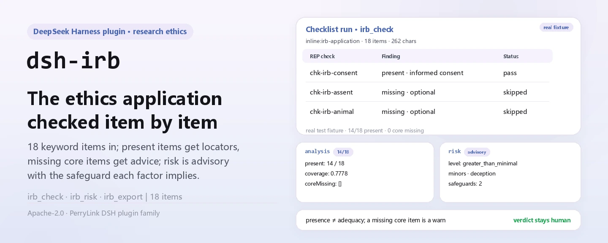
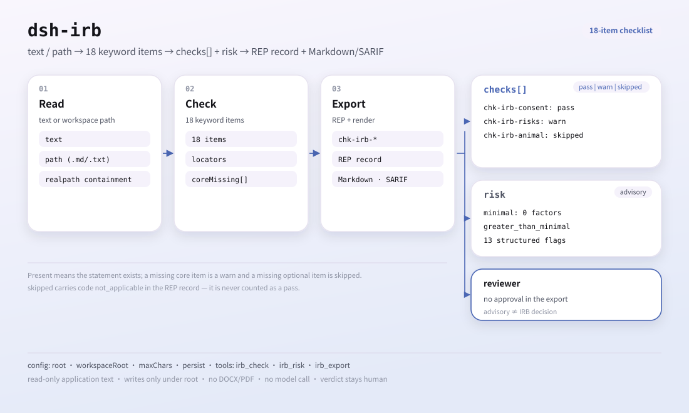
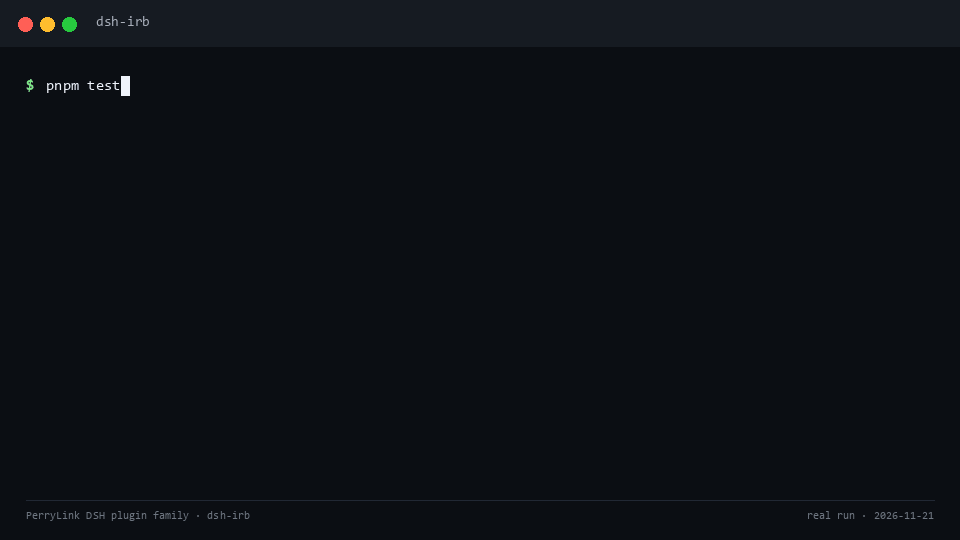

<div align="center">

<picture>
  <source media="(prefers-color-scheme: dark)" srcset="docs/assets/dsh-irb-hero-en-dark.webp">
  
</picture>

# dsh-irb

**Prepara la solicitud de ética antes de que lo haga el comité — y sabe qué declaraciones esenciales siguen faltando.**

*Una lista de comprobación de 18 ítems por palabra clave para solicitudes de ética, un nivel de riesgo orientativo con las salvaguardas que implica y una exportación Markdown + SARIF que puedes adjuntar a la solicitud.*

[English](README.md) · [简体中文](README-zh.md) · [Español](README-es.md) · [Português](README-pt.md) · [हिन्दी](README-hi.md)

[](LICENSE)
[]()

</div>

---

## Qué hace

- **`irb_check`** — 18 ítems: título, IP/contacto, finalidad, diseño, participantes/elegibilidad, reclutamiento, consentimiento informado, asentimiento de menores, riesgos, beneficios, confidencialidad/protección de datos, grupos vulnerables, compensación, conflictos, retención, difusión, ética animal (3R) y bioseguridad/muestras humanas. Los ítems presentes obtienen localizadores de caracteres; los ítems esenciales ausentes obtienen recomendaciones.
- **`irb_risk`** — marcas estructuradas (grupos vulnerables, menores, prisioneros, embarazo, deterioro cognitivo, engaño, temas sensibles, procedimientos invasivos, muestras biológicas, datos genéticos, provocación en humanos, terapia génica, decisiones automatizadas) → nivel orientativo más las salvaguardas que exige cada factor.
- **`irb_export`** — Markdown (tabla de ítems, tabla de riesgo, salvaguardas) + SARIF 2.1.0, además de evidencia REP cuando se comprueba la solicitud.


<picture>
  <source media="(prefers-color-scheme: dark)" srcset="docs/assets/dsh-irb-flow-v5-dark.svg">
  
</picture>

*Estructura: leer → comprobar → exportar; `checks[]` y el `risk` orientativo son las dos salidas, y un ítem opcional ausente queda como `skipped` con `code: not_applicable`, nunca como pass. Las etiquetas internas del diagrama son los nombres reales de herramientas, ítems y campos, así que la misma imagen sirve para los cinco idiomas.*

## Qué no hace

- **Sin aprobación ni asesoramiento jurídico.** Una lista de comprobación no puede sustituir la decisión del IRB/IACUC; la exportación lo dice.
- **Sin juicio de suficiencia.** Detecta si una declaración existe, no si es suficiente.
- **Sin estándar de clasificación del riesgo.** El nivel es orientativo y debe confirmarlo el comité.
- **Sin DOCX/PDF.** Convierte a `.md`/`.txt` (texto de PDF: `dsh-doc-anchor`).
- **Sin integración con el portal de envío.**

## Factores de riesgo y salvaguardas

| Marca | Salvaguarda recomendada |
|---|---|
| grupos vulnerables | procedimientos adicionales de consentimiento/asentimiento y supervisión independiente |
| menores | asentimiento adecuado a la edad más consentimiento de los padres |
| prisioneros | defensor independiente y protección contra la coacción |
| mujeres embarazadas/fetos | evaluación específica del riesgo fetal y materno |
| deterioro cognitivo | evaluación de la capacidad y consentimiento del representante autorizado |
| engaño | sesión informativa posterior y una exención justificada de la divulgación completa |
| temas sensibles | vías de derivación y formación de entrevistadores |
| procedimiento invasivo | supervisión clínica, notificación de eventos adversos y reglas de detención |
| muestras biológicas | manejo de muestras, bioseguridad y consentimiento para uso secundario |
| datos genéticos | consentimiento específico y política de hallazgos incidentales |
| provocación en humanos | comité de monitorización de seguridad y reglas de escalada de dosis |
| terapia génica | seguimiento a largo plazo y aprobación regulatoria |
| decisiones automatizadas | revisión humana y una vía de apelación |

## Herramientas

### `irb_check`

`{ text? | path?, persist? }` → `{ ok, analysis, evidenceId?, recordPath? }`.

### `irb_risk`

`{ vulnerableGroups?, minors?, prisoners?, pregnantWomen?, cognitiveImpairment?, deception?, sensitiveTopics?, invasiveProcedure?, biologicalSamples?, geneticData?, humanChallenge?, geneTherapy?, aiDecisionMaking? }` → `{ ok, risk }`.

### `irb_export`

`{ analysis, risk?, title? }` → `{ ok, markdown, sarif }`.

### Códigos de error

`INVALID_INPUT` · `NOT_FOUND` · `PATH_ESCAPE` · `NOT_A_FILE` · `TOO_LARGE` · `UNSUPPORTED_FILE` · `STORE_ERROR`

## Compatibilidad e instalación

| | |
|---|---|
| DeepSeek Harness | **`dsh-v0.2.2-rc.4`** (verificado 2026-11-18); peer `>=0.2.1-0 <0.3.0 \|\| >=0.2.2-0 <0.3.0` |
| Node | `^22.19.0 \|\| >=24.9.0` (probado en `24.22.1`), solo ESM |
| Pares | `@perrylink/dsh-research-core ^0.1.0`, `@deepseek-ai/cordis ^4.0.5-alpha.1`, `@deepseek-ai/dsh-tools`, `@deepseek-ai/schemastery ^3.18.5-alpha.1` |
| Dependencias en tiempo de ejecución | **cero** |

```sh
dsh plugin --profile <name> add @perrylink/dsh-research-core dsh-irb
dsh --profile <name> --dump-config | grep dsh-irb
```

## Configuración

| Clave | Predeterminado | Significado |
|---|---|---|
| `enabled` | `true` | `false` no monta nada |
| `root` | `.irb` | raíz del almacén y de los registros |
| `workspaceRoot` | `process.cwd()` | las rutas de la solicitud deben resolverse dentro de él |
| `maxChars` | `1000000` | límite de caracteres (falla, nunca trunca) |
| `persist` | `true` | guarda la solicitud comprobada como evidencia REP + registro |

## Límites de seguridad

- Solo lectura sobre la solicitud; escrituras solo bajo `root`.
- Contención mediante `realpath`; DOCX/PDF se rechazan con una indicación de conversión.
- Con `persist: true` (el valor predeterminado) el texto de la solicitud comprobada se guarda como evidencia REP bajo `root`; puede contener datos personales, así que usa `persist: false` o protege el almacén en consecuencia.
- El texto de la solicitud son datos; el contenido con forma de instrucción nunca se ejecuta.

## Evaluación



*Animado: la salida real de `pnpm test` el 2026-11-21 (3 archivos de prueba). El plugin no tiene CLI, así que su propio conjunto de pruebas es la ejecución — lista de comprobación, riesgo orientativo, registro REP y exportación.*


**14 pruebas**: ítems presentes/ausentes de la lista de comprobación y lista de esenciales ausentes, menciones genéricas de consentimiento o comité de ética que no se confunden con asentimiento o contenido animal, rechazo de texto vacío, riesgo mínimo, salvaguardas de menores + engaño, las trece marcas de riesgo, tiempo de ejecución (validez del registro REP, comprobaciones opcionales ausentes registradas como skipped, rechazo de traversals/binarios/exceso de tamaño/vacío), protecciones de las herramientas ante análisis/riesgo malformados, esquemas de las herramientas, de comprobación a riesgo y a exportación de extremo a extremo, ramas de fallo y contrato del paquete.

No se declara ningún benchmark: la presencia de palabras clave está fijada por fixtures; no existe un corpus etiquetado de solicitudes de ética.

## Limitaciones conocidas (v0.1)

- Solo señales de palabras clave en inglés y chino; una declaración redactada de otra forma puede pasarse por alto.
- Las marcas de riesgo vienen de quien llama, no del texto de la solicitud.
- Sin reglas específicas de jurisdicción (detalles de HIPAA, GDPR y 涉及人的生命科学和医学研究伦理审查办法).
- Sin estructura de secciones para protocolos animales más allá de la comprobación de palabras clave 3R.

## Licencia

Apache-2.0. Ningún código de terceros en tiempo de ejecución.
