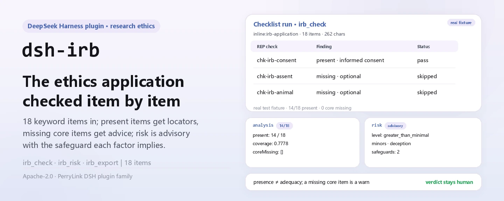
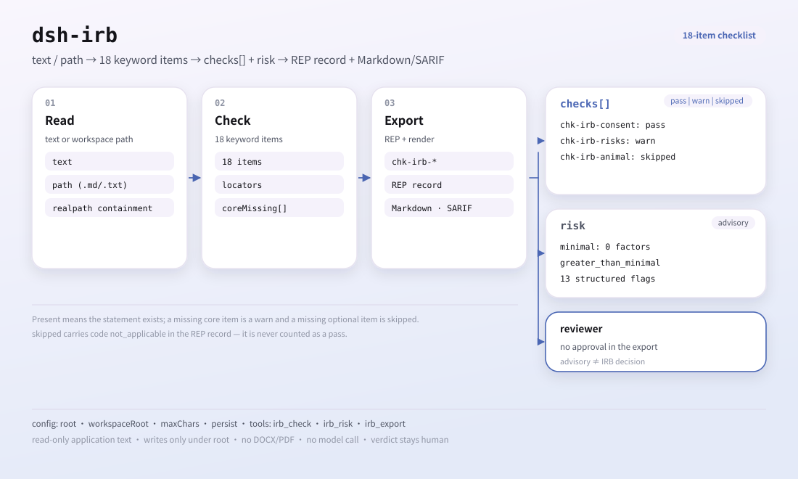
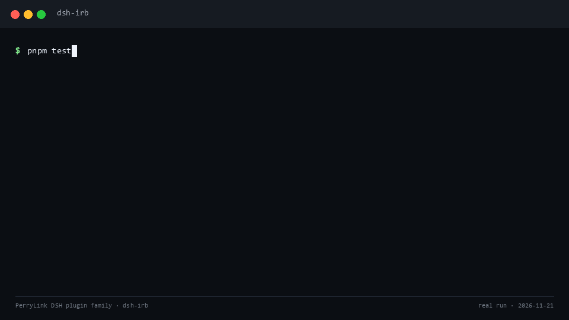

<div align="center">

<picture>
  <source media="(prefers-color-scheme: dark)" srcset="docs/assets/dsh-irb-hero-en-dark.webp">
  
</picture>

# dsh-irb

**समिति से पहले नैतिकता आवेदन तैयार करें — और जानें कि कौन-से मुख्य कथन अभी भी अनुपस्थित हैं।**

*नैतिकता आवेदनों के लिए 18-आइटम वाली कीवर्ड चेकलिस्ट, उसके निहित सुरक्षा उपायों के साथ एक सलाहकारी जोखिम स्तर, और सबमिशन के साथ संलग्न करने योग्य Markdown + SARIF निर्यात।*

[English](README.md) · [简体中文](README-zh.md) · [Español](README-es.md) · [Português](README-pt.md) · [हिन्दी](README-hi.md)

[](LICENSE)
[]()

</div>

---

## यह क्या करता है

- **`irb_check`** — 18 आइटम: शीर्षक, PI/संपर्क, उद्देश्य, अध्ययन डिज़ाइन, प्रतिभागी/पात्रता, भर्ती, सूचित सहमति, नाबालिगों का assent, जोखिम, लाभ, गोपनीयता/डेटा संरक्षण, संवेदनशील समूह, मुआवज़ा, हितों का टकराव, डेटा प्रतिधारण, प्रसार, पशु नैतिकता (3R) और जैव-सुरक्षा/मानव नमूने। उपस्थित आइटमों को कैरेक्टर लोकेटर मिलते हैं; अनुपस्थित मुख्य आइटमों को सलाह मिलती है।
- **`irb_risk`** — संरचित फ़्लैग (संवेदनशील समूह, नाबालिग, कैदी, गर्भावस्था, संज्ञानात्मक कमी, छल, संवेदनशील विषय, आक्रामक प्रक्रिया, जैविक नमूने, आनुवंशिक डेटा, मानव चुनौती, जीन थेरेपी, स्वचालित निर्णय) → सलाहकारी स्तर और प्रत्येक कारक के लिए आवश्यक सुरक्षा उपाय।
- **`irb_export`** — Markdown (आइटम तालिका, जोखिम तालिका, सुरक्षा उपाय) + SARIF 2.1.0, और आवेदन जाँचे जाने पर REP साक्ष्य भी।


<picture>
  <source media="(prefers-color-scheme: dark)" srcset="docs/assets/dsh-irb-flow-v5-dark.svg">
  
</picture>

*संरचना: पढ़ें → जाँचें → निर्यात करें; `checks[]` और सलाहकारी `risk` दो आउटपुट हैं, और अनुपस्थित वैकल्पिक आइटम `code: not_applicable` के साथ `skipped` रहता है, कभी pass नहीं। आरेख के अंदर के टोकन लेबल असली टूल, आइटम और फ़ील्ड नाम हैं, इसलिए एक ही चित्र पाँचों भाषाओं के लिए काम करता है।*

## यह क्या नहीं करता

- **कोई स्वीकृति नहीं, कोई कानूनी सलाह नहीं।** चेकलिस्ट IRB/IACUC के निर्णय का विकल्प नहीं है; निर्यात यह बताता है।
- **पर्याप्तता का निर्णय नहीं।** यह देखता है कि कथन मौजूद है या नहीं, यह नहीं कि वह पर्याप्त है।
- **जोखिम वर्गीकरण का मानक नहीं।** स्तर सलाहकारी है और समिति द्वारा पुष्टि किया जाना चाहिए।
- **DOCX/PDF नहीं।** `.md`/`.txt` में बदलें (PDF टेक्स्ट: `dsh-doc-anchor`)।
- **सबमिशन पोर्टल एकीकरण नहीं।**

## जोखिम कारक और सुरक्षा उपाय

| फ़्लैग | सुझाया गया सुरक्षा उपाय |
|---|---|
| संवेदनशील समूह | अतिरिक्त सहमति/assent प्रक्रियाएँ और स्वतंत्र निगरानी |
| नाबालिग | आयु-उपयुक्त assent और माता-पिता की सहमति |
| कैदी | स्वतंत्र अधिवक्ता और दबाव के विरुद्ध सुरक्षा |
| गर्भवती महिलाएँ/भ्रूण | भ्रूण और मातृ जोखिम का विशिष्ट आकलन |
| संज्ञानात्मक कमी | क्षमता आकलन और अधिकृत प्रतिनिधि की सहमति |
| छल | डीब्रीफ़िंग और पूर्ण प्रकटीकरण से उचित छूट |
| संवेदनशील विषय | रेफ़रल मार्ग और साक्षात्कारकर्ता प्रशिक्षण |
| आक्रामक प्रक्रिया | नैदानिक निगरानी, प्रतिकूल घटना रिपोर्टिंग और रोकने के नियम |
| जैविक नमूने | नमूना प्रबंधन, जैव-सुरक्षा और द्वितीयक उपयोग की सहमति |
| आनुवंशिक डेटा | विशिष्ट सहमति और आकस्मिक-खोज नीति |
| मानव चुनौती | सुरक्षा निगरानी बोर्ड और खुराक-वृद्धि नियम |
| जीन थेरेपी | दीर्घकालिक फ़ॉलो-अप और नियामक स्वीकृति |
| स्वचालित निर्णय | मानव समीक्षा और अपील का मार्ग |

## टूल

### `irb_check`

`{ text? | path?, persist? }` → `{ ok, analysis, evidenceId?, recordPath? }`.

### `irb_risk`

`{ vulnerableGroups?, minors?, prisoners?, pregnantWomen?, cognitiveImpairment?, deception?, sensitiveTopics?, invasiveProcedure?, biologicalSamples?, geneticData?, humanChallenge?, geneTherapy?, aiDecisionMaking? }` → `{ ok, risk }`.

### `irb_export`

`{ analysis, risk?, title? }` → `{ ok, markdown, sarif }`.

### त्रुटि कोड

`INVALID_INPUT` · `NOT_FOUND` · `PATH_ESCAPE` · `NOT_A_FILE` · `TOO_LARGE` · `UNSUPPORTED_FILE` · `STORE_ERROR`

## संगतता और इंस्टॉल

| | |
|---|---|
| DeepSeek Harness | **`dsh-v0.2.2-rc.4`** (2026-11-18 को सत्यापित); peer `>=0.2.1-0 <0.3.0 \|\| >=0.2.2-0 <0.3.0` |
| Node | `^22.19.0 \|\| >=24.9.0` (`24.22.1` पर परीक्षित), केवल ESM |
| Peer | `@perrylink/dsh-research-core ^0.1.0`, `@deepseek-ai/cordis ^4.0.5-alpha.1`, `@deepseek-ai/dsh-tools`, `@deepseek-ai/schemastery ^3.18.5-alpha.1` |
| रनटाइम निर्भरताएँ | **शून्य** |

```sh
dsh plugin --profile <name> add @perrylink/dsh-research-core dsh-irb
dsh --profile <name> --dump-config | grep dsh-irb
```

## कॉन्फ़िगरेशन

| कुंजी | डिफ़ॉल्ट | अर्थ |
|---|---|---|
| `enabled` | `true` | `false` होने पर कुछ भी माउंट नहीं होता |
| `root` | `.irb` | स्टोर/रिकॉर्ड की जड़ |
| `workspaceRoot` | `process.cwd()` | आवेदन के पथ इसी के अंदर हल होने चाहिए |
| `maxChars` | `1000000` | कैरेक्टर सीमा (विफल होती है, कभी काटती नहीं) |
| `persist` | `true` | जाँचे गए आवेदन को REP साक्ष्य + रिकॉर्ड के रूप में रखें |

## सुरक्षा सीमाएँ

- आवेदन पर केवल पढ़ें; लिखें केवल `root` के अंतर्गत।
- `realpath` containment; DOCX/PDF को रूपांतरण संकेत के साथ अस्वीकार किया जाता है।
- `persist: true` (डिफ़ॉल्ट) के साथ जाँचे गए आवेदन का टेक्स्ट `root` के अंतर्गत REP साक्ष्य के रूप में रखा जाता है; इसमें व्यक्तिगत डेटा हो सकता है, इसलिए `persist: false` रखें या स्टोर को उसी अनुसार सुरक्षित करें।
- आवेदन का टेक्स्ट डेटा है; निर्देश जैसी सामग्री कभी निष्पादित नहीं होती।

## मूल्यांकन



*एनिमेटेड: 2026-11-21 को असली `pnpm test` का आउटपुट (3 टेस्ट फ़ाइलें)। इस प्लगइन में CLI नहीं है, इसलिए उसका अपना टेस्ट सूट ही रन है — चेकलिस्ट, सलाहकारी जोखिम, REP रिकॉर्ड और निर्यात।*


**13 टेस्ट**: चेकलिस्ट के उपस्थित/अनुपस्थित आइटम और मुख्य-अनुपस्थित सूची, सामान्य सहमति/नैतिकता-समिति उल्लेख जिन्हें assent/पशु सामग्री नहीं माना जाता, खाली टेक्स्ट अस्वीकृति, न्यूनतम जोखिम, नाबालिग + छल के सुरक्षा उपाय, सभी तेरह जोखिम फ़्लैग, रनटाइम (REP रिकॉर्ड की वैधता, अनुपस्थित वैकल्पिक जाँचें skipped के रूप में दर्ज, traversal/बाइनरी/अत्यधिक आकार/खाली की अस्वीकृति), विकृत analysis/risk के विरुद्ध टूल गार्ड, टूल स्कीमा, जाँच से जोखिम और निर्यात तक एंड-टू-एंड, विफलता शाखाएँ, पैकेज कॉन्ट्रैक्ट।

किसी बेंचमार्क का दावा नहीं: कीवर्ड की उपस्थिति fixture द्वारा तय है; नैतिकता आवेदनों का कोई लेबल किया गया कॉर्पस नहीं है।

## ज्ञात सीमाएँ (v0.1)

- केवल अंग्रेज़ी/चीनी कीवर्ड संकेत; अलग ढंग से लिखा कथन छूट सकता है।
- जोखिम फ़्लैग कॉलर से आते हैं, आवेदन के टेक्स्ट से नहीं।
- किसी विशेष क्षेत्राधिकार के नियम नहीं (HIPAA, GDPR, 涉及人的生命科学和医学研究伦理审查办法 के विवरण)।
- 3R कीवर्ड जाँच से आगे पशु-प्रोटोकॉल अनुभाग संरचना नहीं।

## लाइसेंस

Apache-2.0. रनटाइम में कोई तृतीय-पक्ष कोड नहीं।
