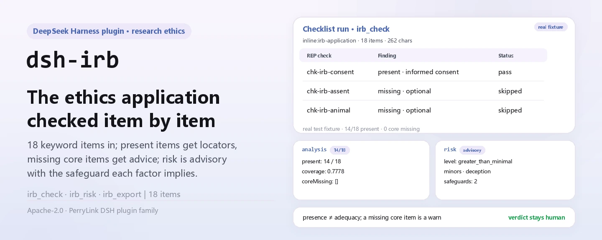
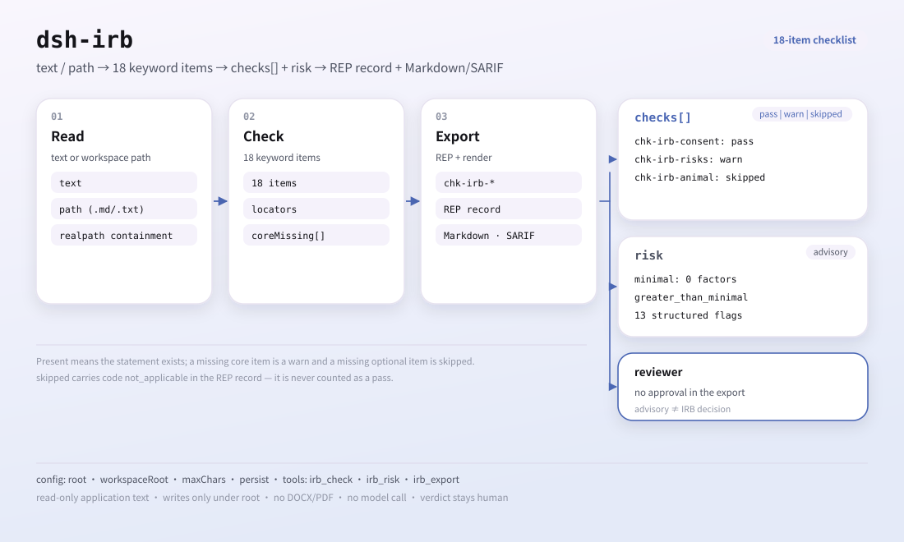
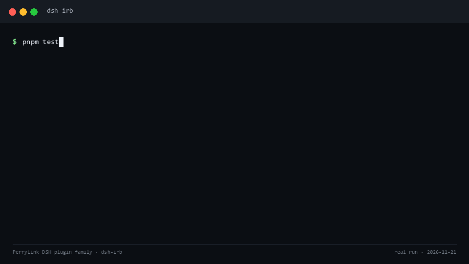

<div align="center">

<picture>
  <source media="(prefers-color-scheme: dark)" srcset="docs/assets/dsh-irb-hero-en-dark.webp">
  
</picture>

# dsh-irb

**Prepare a solicitação de ética antes que o comitê o faça — e saiba quais declarações essenciais ainda faltam.**

*Uma lista de verificação de 18 itens por palavra-chave para solicitações de ética, um nível de risco orientativo com as salvaguardas que ele implica e uma exportação Markdown + SARIF que você pode anexar à submissão.*

[English](README.md) · [简体中文](README-zh.md) · [Español](README-es.md) · [Português](README-pt.md) · [हिन्दी](README-hi.md)

[](LICENSE)
[]()

</div>

---

## O que faz

- **`irb_check`** — 18 itens: título, IP/contato, finalidade, desenho, participantes/elegibilidade, recrutamento, consentimento informado, assentimento de menores, riscos, benefícios, confidencialidade/proteção de dados, grupos vulneráveis, compensação, conflitos, retenção, divulgação, ética animal (3R) e biossegurança/amostras humanas. Os itens presentes recebem localizadores de caracteres; os itens essenciais ausentes recebem recomendações.
- **`irb_risk`** — sinalizadores estruturados (grupos vulneráveis, menores, prisioneiros, gravidez, comprometimento cognitivo, engano, temas sensíveis, procedimentos invasivos, amostras biológicas, dados genéticos, provocação em humanos, terapia gênica, decisões automatizadas) → nível orientativo mais as salvaguardas que cada fator exige.
- **`irb_export`** — Markdown (tabela de itens, tabela de risco, salvaguardas) + SARIF 2.1.0, além de evidência REP quando a solicitação é verificada.


<picture>
  <source media="(prefers-color-scheme: dark)" srcset="docs/assets/dsh-irb-flow-v5-dark.svg">
  
</picture>

*Estrutura: ler → verificar → exportar; `checks[]` e o `risk` orientativo são as duas saídas, e um item opcional ausente fica como `skipped` com `code: not_applicable`, nunca como pass. Os rótulos internos do diagrama são os nomes reais de ferramentas, itens e campos, então a mesma imagem serve aos cinco idiomas.*

## O que não faz

- **Sem aprovação nem orientação jurídica.** Uma lista de verificação não substitui a decisão do IRB/IACUC; a exportação diz isso.
- **Sem julgamento de suficiência.** Detecta se uma declaração existe, não se ela é suficiente.
- **Sem padrão de classificação de risco.** O nível é orientativo e deve ser confirmado pelo comitê.
- **Sem DOCX/PDF.** Converta para `.md`/`.txt` (texto de PDF: `dsh-doc-anchor`).
- **Sem integração com o portal de submissão.**

## Fatores de risco e salvaguardas

| Sinalizador | Salvaguarda recomendada |
|---|---|
| grupos vulneráveis | procedimentos adicionais de consentimento/assentimento e supervisão independente |
| menores | assentimento adequado à idade mais consentimento dos responsáveis |
| prisioneiros | defensor independente e proteção contra coerção |
| gestantes/fetos | avaliação específica do risco fetal e materno |
| comprometimento cognitivo | avaliação de capacidade e consentimento do representante autorizado |
| engano | sessão informativa posterior e dispensa justificada da divulgação completa |
| temas sensíveis | fluxos de encaminhamento e treinamento de entrevistadores |
| procedimento invasivo | supervisão clínica, notificação de eventos adversos e regras de interrupção |
| amostras biológicas | manuseio de amostras, biossegurança e consentimento para uso secundário |
| dados genéticos | consentimento específico e política de achados incidentais |
| provocação em humanos | comitê de monitoramento de segurança e regras de escalonamento de dose |
| terapia gênica | acompanhamento de longo prazo e aprovação regulatória |
| decisões automatizadas | revisão humana e uma via de recurso |

## Ferramentas

### `irb_check`

`{ text? | path?, persist? }` → `{ ok, analysis, evidenceId?, recordPath? }`.

### `irb_risk`

`{ vulnerableGroups?, minors?, prisoners?, pregnantWomen?, cognitiveImpairment?, deception?, sensitiveTopics?, invasiveProcedure?, biologicalSamples?, geneticData?, humanChallenge?, geneTherapy?, aiDecisionMaking? }` → `{ ok, risk }`.

### `irb_export`

`{ analysis, risk?, title? }` → `{ ok, markdown, sarif }`.

### Códigos de erro

`INVALID_INPUT` · `NOT_FOUND` · `PATH_ESCAPE` · `NOT_A_FILE` · `TOO_LARGE` · `UNSUPPORTED_FILE` · `STORE_ERROR`

## Compatibilidade e instalação

| | |
|---|---|
| DeepSeek Harness | **`dsh-v0.2.2-rc.4`** (verificado em 2026-11-18); peer `>=0.2.1-0 <0.3.0 \|\| >=0.2.2-0 <0.3.0` |
| Node | `^22.19.0 \|\| >=24.9.0` (testado em `24.22.1`), apenas ESM |
| Pares | `@perrylink/dsh-research-core ^0.1.0`, `@deepseek-ai/cordis ^4.0.5-alpha.1`, `@deepseek-ai/dsh-tools`, `@deepseek-ai/schemastery ^3.18.5-alpha.1` |
| Dependências de execução | **zero** |

```sh
dsh plugin --profile <name> add @perrylink/dsh-research-core dsh-irb
dsh --profile <name> --dump-config | grep dsh-irb
```

## Configuração

| Chave | Padrão | Significado |
|---|---|---|
| `enabled` | `true` | `false` não monta nada |
| `root` | `.irb` | raiz do armazenamento e dos registros |
| `workspaceRoot` | `process.cwd()` | os caminhos da solicitação devem resolver dentro dele |
| `maxChars` | `1000000` | limite de caracteres (falha, nunca trunca) |
| `persist` | `true` | armazena a solicitação verificada como evidência REP + registro |

## Limites de segurança

- Somente leitura sobre a solicitação; escritas apenas sob `root`.
- Contenção por `realpath`; DOCX/PDF são rejeitados com uma indicação de conversão.
- Com `persist: true` (o padrão) o texto da solicitação verificada é armazenado como evidência REP sob `root`; ele pode conter dados pessoais, então use `persist: false` ou proteja o armazenamento de acordo.
- O texto da solicitação são dados; conteúdo com aparência de instrução nunca é executado.

## Avaliação



*Animado: a saída real de `pnpm test` em 2026-11-21 (3 arquivos de teste). O plugin não tem CLI, então seu próprio conjunto de testes é a execução — lista de verificação, risco orientativo, registro REP e exportação.*


**14 testes**: itens presentes/ausentes da lista de verificação e lista de essenciais ausentes, menções genéricas de consentimento ou comitê de ética que não são confundidas com assentimento ou conteúdo animal, rejeição de texto vazio, risco mínimo, salvaguardas de menores + engano, os treze sinalizadores de risco, execução (validade do registro REP, verificações opcionais ausentes registradas como skipped, rejeição de travessia/binário/excesso de tamanho/vazio), proteções das ferramentas contra análise/risco malformados, esquemas das ferramentas, de verificação a risco e a exportação de ponta a ponta, ramos de falha e contrato do pacote.

Nenhum benchmark é declarado: a presença de palavras-chave é fixada por fixtures; não existe um corpus rotulado de solicitações de ética.

## Limitações conhecidas (v0.1)

- Apenas pistas de palavras-chave em inglês e chinês; uma declaração redigida de outra forma pode passar despercebida.
- Os sinalizadores de risco vêm de quem chama, não do texto da solicitação.
- Sem regras específicas de jurisdição (detalhes de HIPAA, GDPR e 涉及人的生命科学和医学研究伦理审查办法).
- Sem estrutura de seções para protocolos animais além da verificação de palavras-chave 3R.

## Licença

Apache-2.0. Nenhum código de terceiros em tempo de execução.
