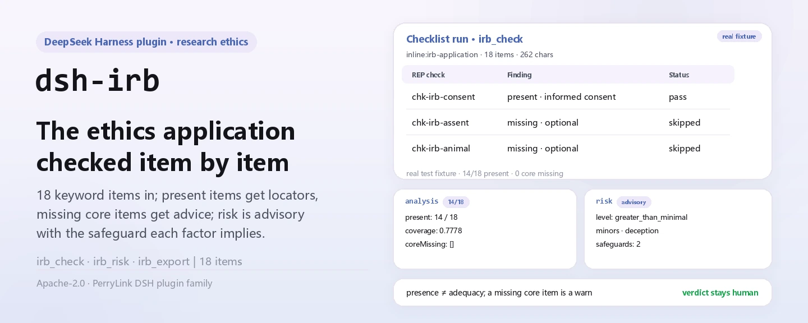
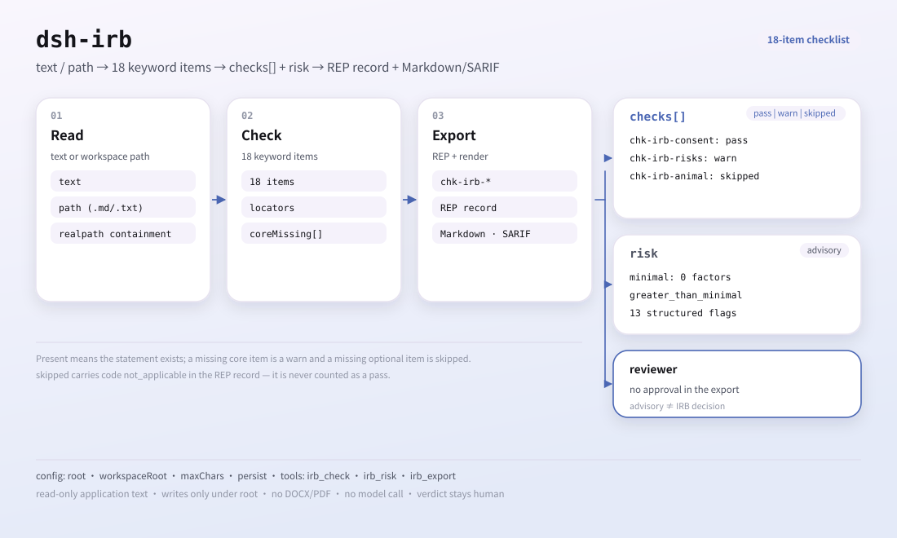
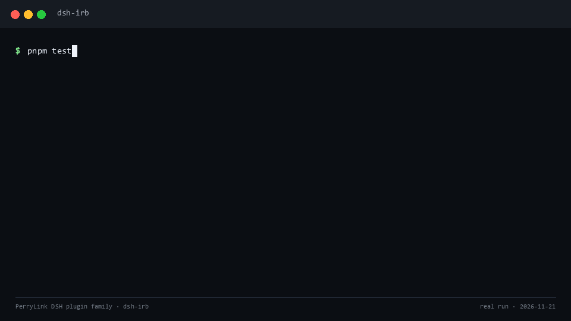

<div align="center">

<picture>
  <source media="(prefers-color-scheme: dark)" srcset="docs/assets/dsh-irb-hero-en-dark.webp">
  
</picture>

# dsh-irb

当前版本 `0.1.4`。

**Assemble the ethics application before the committee does — and know which core statements are still missing.**

*An 18-item keyword checklist for ethics applications, an advisory risk level with the safeguards it implies, and a Markdown + SARIF export you can attach to the submission.*

[简体中文](README-zh.md) · [Español](README-es.md) · [Português](README-pt.md) · [हिन्दी](README-hi.md)

[](LICENSE)
[]()

</div>

---

## What it does

- **`irb_check`** — 18 items: title, PI/contact, purpose, design, participants/eligibility, recruitment, informed consent, assent for minors, risks, benefits, confidentiality/data protection, vulnerable groups, compensation, conflicts, retention, dissemination, animal ethics (3Rs), biosafety/human samples. Present items get character locators; missing core items get advice.
- **`irb_risk`** — structured flags (vulnerable groups, minors, prisoners, pregnancy, cognitive impairment, deception, sensitive topics, invasive procedures, biological samples, genetic data, human challenge, gene therapy, automated decisions) → advisory level plus the safeguards each factor requires.
- **`irb_export`** — Markdown (item table, risk table, safeguards) + SARIF 2.1.0, plus REP evidence when the application is checked.

<picture>
  <source media="(prefers-color-scheme: dark)" srcset="docs/assets/dsh-irb-flow-v5-dark.svg">
  
</picture>

*Structure: read → check → export; `checks[]` and the advisory `risk` are the two outputs, and a missing optional item is `skipped` with `code: not_applicable`, never a pass. The token labels inside the diagram are the real tool, item and field names, so the same picture serves all five languages.*

## What it does not do

- **No approval, no legal advice.** A checklist cannot substitute for the IRB/IACUC decision; the export says so.
- **No adequacy judgement.** It detects whether a statement exists, not whether it is sufficient.
- **No risk classification standard.** The level is advisory and must be confirmed by the committee.
- **No DOCX/PDF.** Convert to `.md`/`.txt` (PDF text: `dsh-doc-anchor`).
- **No submission portal integration.**

## Risk factors and safeguards

| Flag | Safeguard advised |
|---|---|
| vulnerable groups | extra consent/assent procedures and independent oversight |
| minors | age-appropriate assent plus parental consent |
| prisoners | independent advocate and protections against coercion |
| pregnant women/fetuses | specific fetal and maternal risk assessment |
| cognitive impairment | capacity assessment and authorised-representative consent |
| deception | debriefing and a justified waiver of full disclosure |
| sensitive topics | referral pathways and interviewer training |
| invasive procedure | clinical oversight, adverse-event reporting, stopping rules |
| biological samples | sample handling, biosafety, secondary-use consent |
| genetic data | specific consent and incidental-finding policy |
| human challenge | safety monitoring board and dose-escalation rules |
| gene therapy | long-term follow-up and regulatory approval |
| automated decisions | human review and an appeal route |

## Tools

### `irb_check`

`{ text? | path?, persist? }` → `{ ok, analysis, evidenceId?, recordPath? }`.

### `irb_risk`

`{ vulnerableGroups?, minors?, prisoners?, pregnantWomen?, cognitiveImpairment?, deception?, sensitiveTopics?, invasiveProcedure?, biologicalSamples?, geneticData?, humanChallenge?, geneTherapy?, aiDecisionMaking? }` → `{ ok, risk }`.

### `irb_export`

`{ analysis, risk?, title? }` → `{ ok, markdown, sarif }`.

### Error codes

`INVALID_INPUT` · `NOT_FOUND` · `PATH_ESCAPE` · `NOT_A_FILE` · `TOO_LARGE` · `UNSUPPORTED_FILE` · `STORE_ERROR`

## Compatibility & install

| | |
|---|---|
| DeepSeek Harness | **`dsh-v0.2.3-alpha.1`** (verified 2026-11-22); peer `>=0.2.1-0 <0.3.0 \|\| >=0.2.2-0 <0.3.0` |
| Node | `^22.19.0 \|\| >=24.9.0` (tested `24.22.1`), ESM only |
| Peers | `@perrylink/dsh-research-core ^0.1.0`, `@deepseek-ai/cordis ^4.0.5-alpha.1`, `@deepseek-ai/dsh-tools`, `@deepseek-ai/schemastery ^3.18.5-alpha.1` |
| Runtime dependencies | **zero** |

```sh
dsh plugin --profile <name> add @perrylink/dsh-research-core dsh-irb
dsh --profile <name> --dump-config | grep dsh-irb
```

## Configuration

| Key | Default | Meaning |
|---|---|---|
| `enabled` | `true` | `false` mounts nothing |
| `root` | `.irb` | store/record root |
| `workspaceRoot` | `process.cwd()` | application paths must resolve inside it |
| `maxChars` | `1000000` | character cap (fails, never truncates) |
| `persist` | `true` | store the checked application as REP evidence + record |

## Security boundaries

- Read-only on the application; writes only under `root`.
- `realpath` containment; DOCX/PDF rejected with a conversion hint.
- With `persist: true` (the default) the checked application text is stored as REP evidence under `root`; it can contain personal data, so set `persist: false` or protect the store accordingly.
- The application text is data; instruction-like content is never executed.

## Evaluation



*Animated: the real `pnpm test` output on 2026-11-21 (3 test files). The plugin has no CLI, so its own suite is the run — checklist, advisory risk, REP record and export.*

**14 tests**: checklist present/missing items and core-missing list, generic consent/ethics-committee mentions not mistaken for assent/animal content, empty-text rejection, minimal risk, minors+deception safeguards, all thirteen risk flags, runtime (REP record validity, optional-missing checks recorded as skipped, traversal/binary/oversize/empty rejection), malformed analysis/risk tool guards, tool schemas, check→risk→export end to end, failure branches, package contract.

No benchmark is claimed: keyword presence is pinned by fixtures; there is no labelled corpus of ethics applications.

## Known limitations (v0.1)

- English/Chinese keyword cues only; a differently worded statement can be missed.
- Risk flags come from the caller, not from the application text.
- No jurisdiction-specific rules (HIPAA, GDPR, 涉及人的生命科学和医学研究伦理审查办法 details).
- No animal-protocol section structure beyond the 3Rs keyword check.

## License

Apache-2.0. No third-party runtime code.
